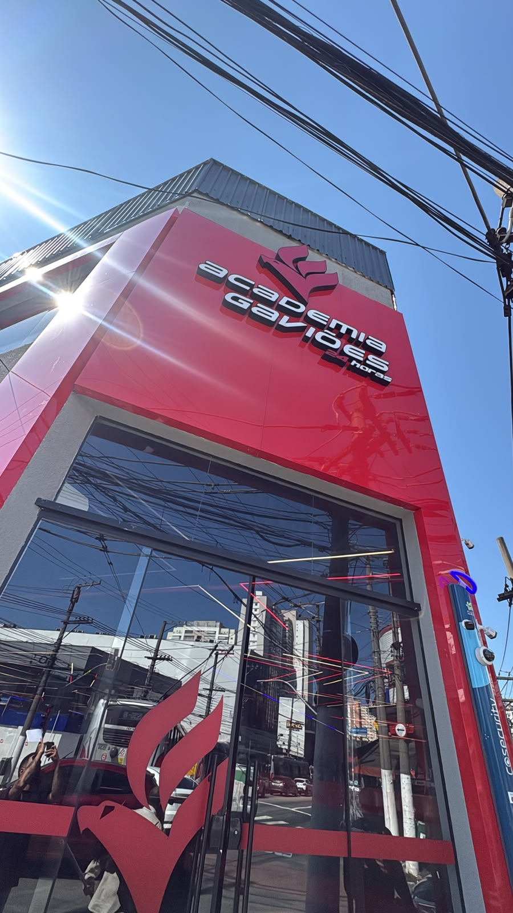
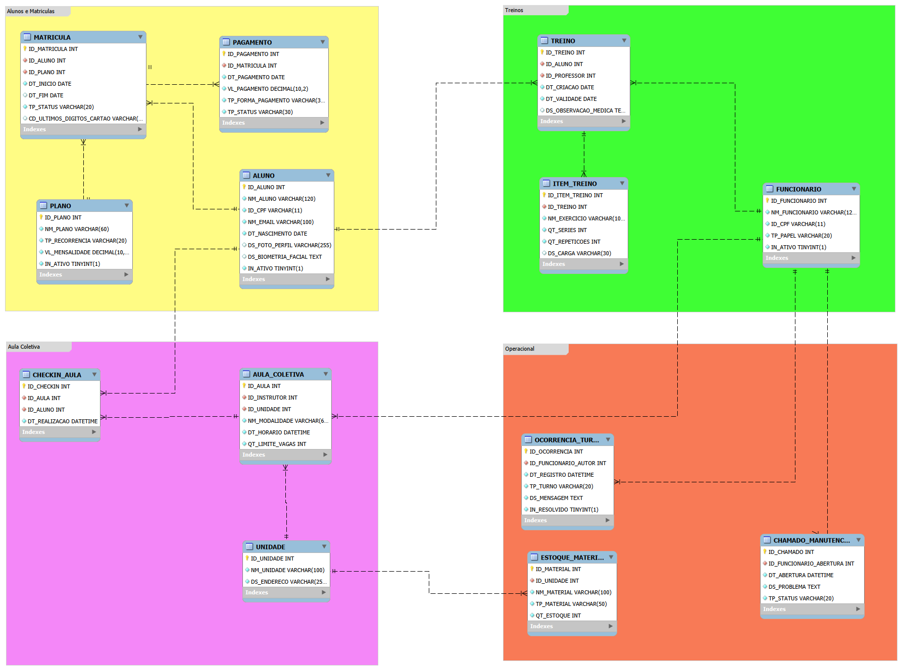

# Entrega 2 — Do modelo ao banco: Academia Gaviões

**Disciplina:** Modelagem de Banco de Dados · **Professor:** Cid Andrade · **Turma:** 2026-2 · **SGBD:** MySQL 8 (InnoDB, `utf8mb4`)

## Integrantes

| Nome completo | RGM | Usuário GitHub |
|---|---|---|
| Edilson Angel Arismendi Huanca | 49423452 | [SlofyDev](https://github.com/SlofyDev) |
| Gabriel Alves Rodrigues | 47818191 | [gbr-alves](https://github.com/gbr-alves) |
| Gabriel Viana de Lima | 48368881 | [gabrielvianadelima1-crypto](https://github.com/gabrielvianadelima1-crypto) |
| João Victor Guimarães Moura | 48298549 | [JoaoGuimaraesOficial](https://github.com/JoaoGuimaraesOficial) |

**Ferramentas utilizadas:** **brModelo**, para a elaboração do DER conceitual, e **MySQL Workbench**, para a elaboração do modelo lógico e de seu respectivo diagrama.

## Sumário

1. [Caracterização da organização](#1-caracterização-da-organização)
2. [Relato da entrevista e observações presenciais](#2-relato-da-entrevista-e-observações-presenciais)
3. [Processos de negócio](#3-processos-de-negócio)
4. [Requisitos funcionais](#4-requisitos-funcionais-rf)
5. [Requisitos não funcionais](#5-requisitos-não-funcionais-rnf)
6. [Regras de negócio](#6-regras-de-negócio-rn)
7. [Revisão do DER (seção 1.1)](#7-revisão-do-der-seção-11)
8. [Conversão do conceitual para o lógico (seção 1.2)](#8-conversão-do-conceitual-para-o-lógico-seção-12)
9. [Normalização (seção 1.4)](#9-normalização-seção-14)
10. [Justificativas técnicas (seção 1.5)](#10-justificativas-técnicas-seção-15)
11. [Proposta de BI e IA (seção 1.6)](#11-proposta-de-bi-e-ia-seção-16)
12. [Limitações conhecidas](#12-limitações-conhecidas)
13. [Registro do uso de inteligência artificial](#13-registro-do-uso-de-inteligência-artificial)
14. [Estrutura do repositório e execução](#14-estrutura-do-repositório-e-execução)

---

## 1. Caracterização da organização

**Situação em relação à Entrega 1:** *Caso A.* Continuamos com a mesma organização da E1, que é real e comprovada. O DER foi revisado a partir da correção (seção 7).

### 1.1 Natureza e contexto

A **Academia Gaviões** é uma empresa com fins lucrativos do setor fitness. A unidade analisada funciona **24 horas por dia**, em quatro turnos (madrugada, manhã, tarde e noite). Faz parte de uma rede: o cadastro facial do aluno vale em outras unidades e problemas que a gerência não resolve vão para o responsável regional.

A equipe tem recepcionistas, professores, funcionários da limpeza, gerente e pessoal do financeiro, mais personal trainers externos. O sistema de gestão é o **Evo**, com aplicativo para o aluno (treino e check-in) e catraca com reconhecimento facial. Os funcionários da unidade são contratados pela própria unidade.

### 1.2 Porte da organização

> Números, não adjetivos. Preenchidas com valores confirmados com a academia, registrando a fonte.

| Indicador | Valor | Fonte / data |
|---|---|---|
| Alunos com matrícula ativa | Não temos esses dados | -- |
| Acessos pela catraca por dia (média) | 1.200 | Entrevista presencial |
| Funcionários (total e por cargo) | cerca de 20 (varia por turno e por cargo) | Entrevista presencial |
| Personal trainers externos credenciados | 2 | Entrevista presencial |
| Planos comercializados | 2 | Site Oficial |
| Aulas coletivas por semana | 4 | Entrevista presencial |
| Bicicletas do spinning (vagas por horário) | 19 | Entrevista presencial |
| Taxa mensal do personal externo | cerca de R$ 400 (varia por unidade) | Entrevista presencial |
| Frequência de reposição de materiais de limpeza | mensal ou a cada três semanas | Entrevista presencial |
| Prazo de inadimplência até o cancelamento automático | cerca de 2 meses (o entrevistado não tinha certeza) | Entrevista presencial |

### 1.3 Problemas identificados

Todos os problemas são resolvidos pelo modelo (a cobertura de P3 e P4 é parcial; ver [limitações](#12-limitações-conhecidas)). A rastreabilidade problema → tabelas → consulta está na [seção 11.3](#113-rastreabilidade-problema--tabelas--consulta).

| Código | Problema | Origem | Como o modelo resolve |
|---|---|---|---|
| **P1** | **Falta de comunicação entre turnos.** Algo que acontece em um turno nem sempre chega à equipe do turno seguinte. Foi o principal ponto de melhoria citado. | Entrevista, itens 17 e 19 | `OCORRENCIA_TURNO` guarda autor, data, turno, mensagem e se foi resolvida. A consulta G05 lista as pendências por turno. |
| **P2** | **Saldo devedor incorreto após cancelamento.** O cancelamento é feito pelo SAC. Quando o sistema falha, o aluno cancelado continua com dívida, é barrado na catraca e a recepção precisa acionar o SAC. Fica pior quando a dívida é de outra unidade. | Entrevista, itens 14, 15 e 19 | `MATRICULA` (status e `DT_FIM`) e `PAGAMENTO` (cobranças e status). A consulta G06 acha cobranças pendentes lançadas depois do cancelamento e a A05 acha cancelamentos incompletos. |
| **P3** | **Falta de controle de materiais.** Houve o caso das garrafinhas promocionais entregues a novos alunos sem controle da quantidade retirada. Os materiais de limpeza são repostos por estimativa. | Entrevista, item 11 | `ESTOQUE_MATERIAL` registra item, categoria (limpeza ou promocional), unidade e quantidade. A consulta G07 lista itens com estoque baixo. |
| **P4** | **Manutenção de equipamentos sem acompanhamento.** Os problemas que aparecem durante o funcionamento precisam ser registrados e encaminhados aos responsáveis. Reparos simples são feitos na hora; os complexos vão ao gerente, ao responsável regional e a uma equipe especializada. | README da E1 (v1.1, item 1.2) e entrevista, item 13 | `CHAMADO_MANUTENCAO` guarda quem abriu, quando, o problema e o status. A consulta G08 lista os chamados não concluídos e há quantos dias estão abertos. |

### 1.4 Escopo e justificativa da escolha

**Escopo:** o banco cobre os dados da unidade em seis áreas.

| Área | Tabelas |
|---|---|
| Alunos e contratos | `ALUNO`, `PLANO`, `MATRICULA`, `PAGAMENTO` |
| Treinos | `TREINO`, `ITEM_TREINO` |
| Aulas coletivas | `AULA_COLETIVA`, `CHECKIN_AULA`, `UNIDADE` |
| Equipe | `FUNCIONARIO` |
| Comunicação | `OCORRENCIA_TURNO` |
| Operação | `CHAMADO_MANUTENCAO`, `ESTOQUE_MATERIAL` |

**Justificativa da escolha:** a academia reúne processos reais e variados (cadastro com biometria facial, planos recorrentes e avulsos, pagamentos, prescrição de treinos, aulas com limite de vagas e níveis diferentes de acesso aos dados). Isso dá a complexidade que a disciplina exige.

**Processos típicos que ficaram de fora e o motivo:**

| Item | Motivo |
|---|---|
| Venda de bebidas e energéticos (geladeira com totem) | Operação terceirizada pela empresa **Gela Fit**; os dados não ficam na academia. |
| Avaliação física e medidas corporais | O entrevistado disse que não há medição de rotina nem registro formal de evolução corporal. |
| Cobrança com número completo de cartão | Fica restrita ao financeiro/central; a recepção e os professores só veem os 4 últimos dígitos. |
| Registro de cada passagem na catraca | Fica no sistema Evo; este banco não guarda log de acessos (ver [limitações](#12-limitações-conhecidas)). |
| Personal trainers externos e taxa mensal | Existem na academia, mas **não estão modeladas** nesta versão (ver [limitações](#12-limitações-conhecidas)). |
| Emissão de nota fiscal, trancamento de plano, aula experimental, convênios (Wellhub, TotalPass) e reajuste de mensalidade | A E1 os lista como regras prováveis "a definir". Não foram confirmados na entrevista (a transcrição não os cita), então ficam **fora** do modelo até a academia confirmar. |

### 1.5 Evidências da existência da organização

- **Endereço:** Av. Celso Garcia, 5492 — Tatuapé, São Paulo/SP, CEP 03064-000.
- **Google Meu Negócio / Maps:** <https://share.google/RPpl0luAjH1SzWWri>
- **Fotos da visita (JPG), pasta [`Arq-visita-comprovante`](Arq-visita-comprovante/):**

| Arquivo | O que mostra |
|---|---|
| [`01-fachada-grupo.jpg`](Arq-visita-comprovante/d027150e-6f19-4159-a3fc-ffbaba051499.jpg) | Integrantes do grupo na fachada da Academia Gaviões 24 horas. |
| [`02-entrevista-recepcao.jpg`](Arq-visita-comprovante/comprovante-entrevista-responsavel.jpeg) | Entrevista com a recepção, no balcão da academia. |
| [`03-interior-academia.jpg`](Arq-visita-comprovante/c27ab983-a431-41c5-ac05-9aa6a47b8f58.jpg) | Área de musculação, com a catraca à direita da imagem. |




### 1.6 Responsável entrevistado e vínculo

| Item | Dados |
|---|---|
| Entrevistados | Eduardo Curzio e Letícia (recepcionistas), conforme a E1. |
| Telefone / contato | (11) 94074-7584 |
| Vínculo do grupo com a organização | Nenhum |
| Acesso para voltar a campo | sim |

---

## 2. Relato da entrevista e observações presenciais

O texto completo está em [`levantamento/levantamento.md`](levantamento/levantamento.md)

### 2.1 Entrevista

| Item | Dados |
|---|---|
| Entrevistados | Recepção da unidade (ver 1.6) |
| Participantes do grupo | Todos Participaram |
| Data e horário | 05/11/2026 |
| Local | Recepção da Academia Gaviões, Av. Celso Garcia, 5492 (no ambiente da organização) |
| Foto | [`02-entrevista-recepcao.jpg`](Arq-visita-comprovante/02-entrevista-recepcao.jpg) |
| Roteiro usado | 9 blocos (visão geral, cadastros, planos e pagamentos, frequência e treinos, aulas, estoque e equipamentos, sistema e acessos, problemas, observação) |

**O que foi dito**

- Cadastro no **Evo**, com dados pessoais e foto. O cadastro facial vale para outras unidades. A recepção busca o aluno por nome, CPF ou e-mail e pode corrigir dados, como um telefone.
- Problemas de saúde podem ser digitalizados e anexados ao sistema (inclusive em PDF). Documentos físicos ficam, ao que parece, na sala do gerente. O entrevistado não soube dizer por quanto tempo são guardados.
- **Plano recorrente:** cartão de crédito cadastrado e cobrança automática mensal. **Não recorrente:** PIX, dinheiro, crédito ou débito.
- A recepção vê se o pagamento foi feito, se o cartão foi recusado e se há saldo devedor. Após cerca de dois meses sem pagar, o plano pode ser cancelado pelo sistema.
- A catraca usa reconhecimento facial. Se falhar, a recepção libera manualmente. Existe também um portão para algumas situações.
- Os professores montam o treino conforme experiência, tempo de prática e limitações físicas. O treino fica no aplicativo, em categorias (A, B, C, superior, inferior). O aluno também pode montar um treino num totem. O treino tem validade e outro professor pode renová-lo se o autor sair.
- Aulas coletivas durante a semana e aos sábados. O **spinning** tem 19 bicicletas e exige check-in pelo aplicativo. Boxe, muay thai e outras normalmente não exigem agendamento.
- **Professores** veem CPF, ID do aluno e dados do treino, sem dados cadastrais completos, medidas, financeiro nem cartão. A **recepção** tem acesso mais amplo. O **gerente** consulta matrículas, acessos e financeiro. O número completo do cartão fica com o financeiro/central; só aparecem os 4 últimos dígitos.
- **Personal trainers externos** pagam cerca de R$ 400 e levam seus alunos, com regras que variam por unidade.
- Estoque: materiais de limpeza (papel, álcool, Lysoform etc.) repostos todo mês ou a cada três semanas. As garrafinhas promocionais ficaram sem controle da quantidade retirada. A geladeira de bebidas é da Gela Fit (terceirizada).
- Manutenção simples é feita por funcionários ou professores. O que é mais complexo vai ao gerente, depois ao responsável regional, e uma equipe especializada pode ser enviada.
- Cancelamento só pelo SAC (e-mail com CPF). Falhas geram saldo devedor incorreto e bloqueio na catraca.
- Principal dor: **comunicação entre turnos**. Na madrugada pode haver só um recepcionista e a equipe aumenta no fim da tarde e à noite.

**Onde o entrevistado demonstrou dúvida** (mantido como incerto): tempo de guarda dos documentos, prazo exato de cancelamento por inadimplência e política de exclusão de dados de ex-funcionários.

### 2.2 Observação presencial (separada do que foi dito)

| O que o grupo viu | Diferença em relação ao relato |
|---|---|
| **Recepção e catraca:** a fotografia da área interna registra a catraca próxima à área de musculação. A visita também foi documentada na recepção da academia. | O reconhecimento facial, a consulta da situação do aluno e a liberação manual em caso de falha foram explicados na entrevista. Não há confirmação de que o grupo tenha acompanhado esses procedimentos funcionando. |
| **Comunicação entre turnos:** a entrevista ocorreu no balcão da recepção, conforme o registro fotográfico. | Os entrevistados relataram dificuldades na transmissão de informações entre os quatro turnos. Não foi documentada a observação direta da troca de turnos ou do local utilizado para registrar recados. |
| **Estoque de materiais:** as fotografias disponíveis registram a fachada, a recepção e parte da área interna da academia. | A reposição dos materiais de limpeza e a falta de controle na retirada de garrafinhas promocionais foram relatadas na entrevista. O local de armazenamento dos materiais não foi identificado nos registros da visita. |

---

## 3. Processos de negócio

Os processos de negócio foram identificados a partir da entrevista realizada na Academia Gaviões e das informações levantadas sobre o funcionamento da unidade. Foram organizados dez processos principais, envolvendo cadastro, matrícula, pagamento, acesso, cancelamento, treinos, aulas coletivas, comunicação entre turnos, manutenção e estoque.

Os campos citados correspondem às informações do [dicionário de dados](dicionario_dados.html) e do [script SQL](docs/academia_gavioes.sql). Algumas atividades são realizadas no sistema Evo ou por setores externos e não estão totalmente representadas no banco desenvolvido.

### 3.1 Resumo dos processos

| Código | Processo | Descrição |
|---|---|---|
| PR01 | **Cadastro do aluno** | A recepção registra os dados pessoais do aluno no Evo, incluindo nome, CPF, e-mail, nascimento e, quando aplicável, foto e biometria facial. |
| PR02 | **Matrícula** | O aluno escolhe um plano e a recepção registra o vínculo, as datas e a situação da matrícula. |
| PR03 | **Pagamento** | O pagamento é registrado com valor, data, forma e status. Pendências podem afetar a situação da matrícula. |
| PR04 | **Controle de acesso** | A catraca verifica a identificação facial e a situação da matrícula para liberar ou bloquear a entrada. |
| PR05 | **Cancelamento** | O aluno solicita o cancelamento ao SAC, que realiza o procedimento e atualiza a situação da matrícula. |
| PR06 | **Prescrição de treinos** | O professor monta a ficha de treino do aluno, com exercícios, séries, repetições, cargas e prazo de validade. |
| PR07 | **Aulas e check-in** | O aluno consulta as aulas disponíveis e realiza check-in quando a modalidade exige agendamento. |
| PR08 | **Comunicação entre turnos** | Os funcionários registram avisos e ocorrências para acompanhamento pelos turnos seguintes. |
| PR09 | **Manutenção** | Problemas nos equipamentos ou instalações são registrados e encaminhados aos responsáveis. |
| PR10 | **Controle de estoque** | A equipe acompanha a quantidade de materiais disponíveis e identifica a necessidade de reposição. |

### 3.2 Detalhamento dos processos

#### PR01 — Cadastro do aluno

| Campo | Descrição |
|---|---|
| Responsáveis | Aluno e recepção. |
| Início | O aluno procura a academia para realizar o cadastro. |
| Etapa 1 | A recepção solicita nome completo, CPF, e-mail e data de nascimento. |
| Etapa 2 | Os dados são conferidos e registrados no sistema Evo. |
| Etapa 3 | A foto de perfil e a biometria facial podem ser cadastradas. |
| Etapa 4 | A recepção verifica as informações antes de concluir o cadastro. |
| Informações utilizadas | Nome, CPF, e-mail, nascimento, foto e biometria facial. |
| Exceções | Dados incorretos ou incompletos precisam ser corrigidos. |
| Resultado | Aluno cadastrado e disponível para matrícula. |
| Integração | `ALUNO`. O reconhecimento facial é utilizado pelo Evo. |

#### PR02 — Matrícula

| Campo | Descrição |
|---|---|
| Responsáveis | Aluno e recepção. |
| Início | O aluno cadastrado decide contratar um plano. |
| Etapa 1 | A recepção apresenta os planos disponíveis e seus valores. |
| Etapa 2 | O aluno escolhe o plano conforme suas necessidades. |
| Etapa 3 | O sistema registra o vínculo entre aluno e plano. |
| Etapa 4 | São registradas a data de início e a situação da matrícula. |
| Etapa 5 | No plano recorrente, podem ser armazenados os quatro últimos dígitos do cartão. |
| Informações utilizadas | Aluno, plano, tipo de recorrência, mensalidade, datas e status. |
| Exceções | Problemas nos dados ou na contratação precisam ser verificados pela recepção. |
| Resultado | Matrícula vinculada ao aluno e ao plano escolhido. |
| Integração | `ALUNO`, `PLANO` e `MATRICULA`. |

#### PR03 — Pagamento

| Campo | Descrição |
|---|---|
| Responsáveis | Financeiro, sistema Evo e recepção para consulta. |
| Início | Existe uma cobrança relacionada à matrícula do aluno. |
| Etapa 1 | O sistema identifica a matrícula e o valor correspondente. |
| Etapa 2 | Nos planos recorrentes, a cobrança é realizada automaticamente no cartão cadastrado. |
| Etapa 3 | Nos planos não recorrentes, o pagamento pode ser feito por PIX, dinheiro, crédito ou débito. |
| Etapa 4 | São registrados o valor, a data, a forma de pagamento e o status. |
| Etapa 5 | A situação financeira fica disponível para consulta. |
| Informações utilizadas | Matrícula, valor, data, forma de pagamento e status. |
| Exceções | Pagamentos recusados ou não confirmados podem deixar a matrícula pendente ou inadimplente. |
| Resultado | Pagamento registrado e situação financeira identificada. |
| Integração | `MATRICULA` e `PAGAMENTO`. |

#### PR04 — Controle de acesso

| Campo | Descrição |
|---|---|
| Responsáveis | Sistema de catraca e recepção. |
| Início | O aluno chega à academia e tenta entrar. |
| Etapa 1 | A catraca realiza a identificação facial. |
| Etapa 2 | O sistema consulta a situação da matrícula. |
| Etapa 3 | Se a identificação e a matrícula estiverem regulares, a entrada é liberada. |
| Etapa 4 | Se houver bloqueio financeiro, a entrada não é liberada. |
| Etapa 5 | Caso o reconhecimento facial falhe, a recepção verifica a situação do aluno. |
| Etapa 6 | Quando autorizado, o funcionário pode liberar a entrada manualmente. |
| Informações utilizadas | Identificação facial, cadastro do aluno e situação da matrícula. |
| Exceções | Falha na biometria, inadimplência ou inconsistência cadastral. |
| Resultado | Entrada liberada ou bloqueada. |
| Integração | `ALUNO` e `MATRICULA`. O registro das passagens fica no Evo, fora deste banco. |

#### PR05 — Cancelamento

| Campo | Descrição |
|---|---|
| Responsáveis | Aluno e SAC. |
| Início | O aluno solicita o cancelamento do plano. |
| Etapa 1 | O aluno envia a solicitação ao SAC por e-mail, informando o CPF. |
| Etapa 2 | O SAC identifica a matrícula e verifica a situação do aluno. |
| Etapa 3 | O setor responsável realiza o procedimento de cancelamento. |
| Etapa 4 | A matrícula recebe o status `cancelado` e a data de encerramento. |
| Etapa 5 | O aluno recebe a confirmação do atendimento. |
| Informações utilizadas | CPF, matrícula, situação financeira, data de fim e status. |
| Exceções | Falhas no cancelamento podem gerar saldo devedor incorreto e bloqueio na catraca. A recepção encaminha essas situações ao SAC. |
| Resultado | Matrícula cancelada e situação atualizada. |
| Integração | `MATRICULA` e `PAGAMENTO`. O atendimento do SAC não possui tabela própria neste modelo. |

#### PR06 — Prescrição de treinos

| Campo | Descrição |
|---|---|
| Responsáveis | Professor e aluno. |
| Início | O aluno precisa de uma ficha de treino. |
| Etapa 1 | O professor consulta as informações necessárias sobre o aluno. |
| Etapa 2 | São consideradas a experiência, o tempo de prática e as limitações físicas informadas. |
| Etapa 3 | O professor seleciona os exercícios. |
| Etapa 4 | São definidas as séries, repetições e cargas, quando aplicável. |
| Etapa 5 | A ficha recebe data de criação e validade. |
| Etapa 6 | O treino fica disponível para consulta no aplicativo. |
| Etapa 7 | Quando necessário, a ficha pode ser renovada por outro professor. |
| Informações utilizadas | Aluno, professor, exercícios, séries, repetições, cargas, datas e observações médicas. |
| Exceções | Treinos vencidos ou mudanças nas limitações do aluno podem exigir atualização. |
| Resultado | Ficha de treino criada ou atualizada. |
| Integração | `ALUNO`, `FUNCIONARIO`, `TREINO` e `ITEM_TREINO`. |

#### PR07 — Aulas e check-in

| Campo | Descrição |
|---|---|
| Responsáveis | Aluno, instrutor e sistema Evo. |
| Início | O aluno deseja participar de uma aula coletiva. |
| Etapa 1 | O aluno consulta as modalidades e os horários disponíveis. |
| Etapa 2 | O sistema identifica a aula, o instrutor, a unidade e o limite de vagas. |
| Etapa 3 | Quando a modalidade exige agendamento, o aluno realiza o check-in pelo aplicativo. |
| Etapa 4 | São verificadas as vagas disponíveis. |
| Etapa 5 | O check-in é associado ao aluno e à aula. |
| Etapa 6 | O instrutor realiza a atividade no horário previsto. |
| Informações utilizadas | Aluno, modalidade, instrutor, unidade, horário, limite de vagas e check-in. |
| Exceções | Falta de vagas ou tentativa de check-in duplicado. O spinning possui 19 bicicletas e exige check-in; outras modalidades normalmente não exigem reserva. |
| Resultado | Participação ou check-in registrado, conforme a modalidade. |
| Integração | `ALUNO`, `FUNCIONARIO`, `UNIDADE`, `AULA_COLETIVA` e `CHECKIN_AULA`. |

#### PR08 — Comunicação entre turnos

| Campo | Descrição |
|---|---|
| Responsáveis | Funcionários e gerência. |
| Início | Um funcionário identifica uma ocorrência ou informação que precisa ser comunicada. |
| Etapa 1 | O funcionário descreve o problema ou aviso. |
| Etapa 2 | A ocorrência é registrada com data, horário e turno. |
| Etapa 3 | O registro fica disponível para acompanhamento. |
| Etapa 4 | A equipe do turno seguinte consulta as informações pendentes. |
| Etapa 5 | Quando a situação é resolvida, o registro é atualizado. |
| Informações utilizadas | Funcionário responsável, data, horário, turno, mensagem e situação da ocorrência. |
| Exceções | Ocorrências não comunicadas podem permanecer pendentes entre os turnos. |
| Resultado | Avisos e problemas registrados para acompanhamento. |
| Integração | `FUNCIONARIO` e `OCORRENCIA_TURNO`. |

#### PR09 — Manutenção

| Campo | Descrição |
|---|---|
| Responsáveis | Funcionários, professores, gerente e equipe de manutenção. |
| Início | É identificado um problema em equipamento ou instalação. |
| Etapa 1 | O funcionário verifica o problema identificado. |
| Etapa 2 | Problemas simples podem ser resolvidos pela equipe da unidade. |
| Etapa 3 | Quando necessário, é aberto um chamado de manutenção. |
| Etapa 4 | O chamado registra a data, o responsável e a descrição do problema. |
| Etapa 5 | Problemas mais complexos são encaminhados ao gerente e, quando necessário, ao responsável regional. |
| Etapa 6 | O chamado é acompanhado até a conclusão. |
| Informações utilizadas | Funcionário, data de abertura, descrição do problema e status. |
| Exceções | Problemas complexos podem depender de atendimento especializado. |
| Resultado | Problema registrado e encaminhado para resolução. |
| Integração | `FUNCIONARIO` e `CHAMADO_MANUTENCAO`. O escalonamento regional não é registrado separadamente no banco. |

#### PR10 — Controle de estoque

| Campo | Descrição |
|---|---|
| Responsáveis | Funcionários e gerência. |
| Início | É necessário consultar ou repor materiais utilizados na unidade. |
| Etapa 1 | A equipe verifica os materiais disponíveis. |
| Etapa 2 | São consultados o nome, a categoria e a quantidade de cada material. |
| Etapa 3 | Materiais com estoque reduzido são identificados. |
| Etapa 4 | A necessidade de reposição é comunicada ao responsável. |
| Etapa 5 | Após a reposição, a quantidade disponível é atualizada. |
| Informações utilizadas | Unidade, nome do material, categoria e quantidade em estoque. |
| Exceções | Falta de materiais e divergências de quantidade podem dificultar o controle. A retirada individual de itens ainda não é registrada neste modelo. |
| Resultado | Estoque atualizado e necessidade de reposição identificada. |
| Integração | `UNIDADE` e `ESTOQUE_MATERIAL`. |

### 3.3 Relação entre os processos

| Processos relacionados | Relação |
|---|---|
| PR01 e PR02 | O aluno precisa estar cadastrado para ser vinculado a uma matrícula. |
| PR02 e PR03 | A matrícula está associada ao plano contratado e aos pagamentos. |
| PR03 e PR04 | A situação financeira pode influenciar a liberação de acesso. |
| PR04 e PR05 | O cancelamento altera a situação da matrícula utilizada na verificação de acesso. |
| PR06 e PR07 | Os treinos e as aulas coletivas fazem parte dos serviços oferecidos aos alunos. |
| PR08 e PR09 | Ocorrências entre turnos podem envolver problemas de manutenção. |
| PR08 e PR10 | A comunicação entre turnos pode incluir avisos sobre falta de materiais. |

Os processos apresentados representam as principais atividades da Academia Gaviões relacionadas ao banco de dados desenvolvido. Algumas operações dependem do sistema Evo, do SAC ou de controles externos, conforme as limitações descritas nas demais seções do projeto.
## 4. Requisitos funcionais (RF)

RF01 a RF10 são os da E1 v1.1 (códigos mantidos). RF11 é novo. A coluna **No banco** diz com franqueza o quanto cada requisito está implementado.

| Código | Requisito | No banco |
|---|---|---|
| RF01 | Cadastro de alunos com dados pessoais (nome completo, CPF, e-mail, nascimento), foto, biometria facial e documentação de saúde. | **Parcial.** `ALUNO` completo; a saúde está só em `TREINO.DS_OBSERVACAO_MEDICA`. |
| RF02 | Cadastro de planos, vínculo com alunos e registro de pagamento, cancelamento e condições contratuais. | **Parcial.** `PLANO`, `MATRICULA` e `PAGAMENTO`; cancelamento só por status e `DT_FIM`; sem fidelidade nem multa. |
| RF03 | Liberar ou bloquear a catraca conforme a situação da matrícula e financeira. | **Parcial.** Situação em `MATRICULA.TP_STATUS` e `ALUNO.IN_ATIVO`; o log de acessos fica no Evo. |
| RF04 | Professores criam, editam e consultam fichas de treino, considerando limitações dos alunos. | **Atendido.** `TREINO` e `ITEM_TREINO`. |
| RF05 | Check-in em aulas coletivas, respeitando o limite de vagas. | **Parcialmente atendido.** `CHECKIN_AULA`; excesso detectado pela A01. |
| RF06 | Registrar avisos e pendências dos turnos, mantendo-as disponíveis até serem resolvidas. | **Atendido.** `OCORRENCIA_TURNO` e G05. |
| RF07 | Registro e acompanhamento de problemas e solicitações de manutenção. | **Parcial.** `CHAMADO_MANUTENCAO` e G08; sem equipamento nem escalonamento. |
| RF08 | Acompanhar materiais internos e itens promocionais, incluindo retiradas por funcionários. | **Parcial.** `ESTOQUE_MATERIAL` (quantidade atual); sem registro de retiradas. |
| RF09 | Cadastro de funcionários e personal trainers externos, com situação e habilitação (CREF). | **Parcial.** `FUNCIONARIO`; personal externo e CREF não modelados. |
| RF10 | Verificar permissões de acesso a outras unidades conforme o plano. | **Não atendido.** `PLANO` não tem o atributo. |
| RF11 | Gerar consultas gerenciais e de auditoria *(novo)*. | **Atendido.** G01 a G08 e A01 a A06 ([seção 11](#11-proposta-de-bi-e-ia-seção-16)). |

---

## 5. Requisitos não funcionais (RNF)

RNF01 a RNF03 são os da E1. RNF04 e RNF05 são novos.

| Código | Categoria | Requisito |
|---|---|---|
| RNF01 | Segurança e privacidade | Acesso por papéis: professores não veem dados financeiros nem o número completo do cartão. |
| RNF02 | Disponibilidade | A validação na catraca funciona 24 horas, com resposta em menos de 2 segundos. |
| RNF03 | Integridade | O histórico de treinos é preservado mesmo após o desligamento do professor. |
| RNF04 | LGPD *(novo)* | Biometria e informação de saúde são dados sensíveis. O cartão é guardado só pelos 4 últimos dígitos. |
| RNF05 | Plataforma *(novo)* | MySQL 8, InnoDB (chaves estrangeiras) e `utf8mb4`. |

---

## 6. Regras de negócio (RN)

RN01 a RN12 são as da E1 v1.1 (códigos mantidos, como pede o enunciado). RN13 a RN19 são novas e **estão implementadas no script**. A coluna **No banco** é franca sobre o que ainda não está.

| Código | Regra | No banco |
|---|---|---|
| RN01 | O cancelamento de plano só ocorre por solicitação formal via SAC. | **Não implementada** (sem tabela de cancelamento). O efeito aparece em `MATRICULA` (`cancelado` e `DT_FIM`), auditado por A05. |
| RN02 | Inadimplência prolongada (cerca de 60 dias) pode cancelar o plano e bloquear a catraca. | **Parcial.** `TP_STATUS = 'inadimplente'`. O prazo não é automatizado. Auditorias A05 e A06. |
| RN03 | O spinning tem 19 vagas por horário, com check-in obrigatório pelo aplicativo. | **Parcial.** CHECK `QT_LIMITE_VAGAS > 0` e auditoria A01; o banco não impede o excesso, a A01 o detecta. |
| RN04 | Personal externo só atua com cadastro ativo e taxa mensal paga. | **Não implementada.** |
| RN05 | Recepção e professores só veem os 4 últimos dígitos do cartão. | **Atendida.** `CD_ULTIMOS_DIGITOS_CARTAO VARCHAR(4)`; o número completo nunca é guardado. |
| RN06 | Informações de saúde e limitações ficam anexadas ao cadastro em formato digital. | **Parcial.** Só o texto em `TREINO.DS_OBSERVACAO_MEDICA`; o anexo PDF/imagem não está modelado. |
| RN07 | A matrícula exige idade mínima e atestado médico ou PAR-Q. | **Parcial.** Existe `ALUNO.DT_NASCIMENTO`; a idade mínima e o atestado não são validados. |
| RN08 | O acesso a outras unidades depende do plano contratado. | **Não implementada.** |
| RN09 | Planos com fidelidade têm multa em cancelamento antecipado. | **Não implementada.** |
| RN10 | Toda retirada de material registra funcionário, material, quantidade e data. | **Não implementada** (sem tabela de movimentação). |
| RN11 | Ocorrências pendentes passam ao turno seguinte até serem resolvidas. | **Parcial.** `IN_RESOLVIDO` e G05 listam as pendentes; a transferência não é automática. |
| RN12 | Todo professor deve ter registro ativo no CREF. | **Não implementada** (sem atributo de CREF). |
| RN13 | `DT_FIM` da matrícula não pode ser anterior a `DT_INICIO`. *(novo)* | CHECK `CHK_MATRICULA_DATAS` |
| RN14 | O status da matrícula é pago, pendente, inadimplente ou cancelado. *(novo)* | CHECK `CHK_MATRICULA_STATUS` |
| RN15 | Cada aluno faz no máximo um check-in por aula. *(novo)* | UNIQUE `UK_CHECKIN_AULA_ALUNO` |
| RN16 | Pagamento tem valor maior que zero, forma e status válidos. *(novo)* | CHECKs `CHK_PAGAMENTO_*` |
| RN17 | O turno da ocorrência é madrugada, manhã, tarde ou noite. *(novo)* | CHECK `CHK_OCORRENCIA_TURNO` |
| RN18 | Mensalidade maior que zero e recorrência `recorrente` ou `não recorrente`. *(novo)* | CHECKs `CHK_PLANO_*` |
| RN19 | Estoque nunca é negativo e a validade do treino não é anterior à criação. *(novo)* | CHECKs `CHK_ESTOQUE_QUANTIDADE` e `CHK_TREINO_DATAS` |

---

## 7. Revisão do DER (seção 1.1)

- DER conceitual revisado: [`Arq-DER/modelo-conceitual.png`](Arq-DER/modelo-conceitual.png) (brModelo)
- Modelo lógico: [`Arq-DER/modelo-logico.png`](Arq-DER/modelo-logico.png)


### 7.1 Apontamentos da correção e respostas

| Apontamento da E1 | O que mudou | Por quê |
|---|---|---|
| Chaves estrangeiras no DER conceitual (`ID_ALUNO`, `ID_PLANO`, `ID_PROFESSOR`…) | Removidas dos atributos; as ligações aparecem só pelos losangos e cardinalidades | FK é decisão do modelo lógico. |
| I05: normalização, com exercícios misturados na ficha de treino (`1{ITEM_EXERCICIO}100`) | `TREINO` e `ITEM_TREINO` separadas, ligadas em (1,n)–(1,1) | Um treino tem vários exercícios com campos próprios (1FN). |
| Pagamento só como status e 4 dígitos na matrícula | Entidade `PAGAMENTO` ligada à matrícula | Sem pagamentos não há como investigar o saldo devedor incorreto (P2). |
| Estoque citado (RF08, P3) sem entidade | Entidade `ESTOQUE_MATERIAL` | Problema declarado precisa aparecer no DER. |
| Manutenção citada (RF07) sem entidade | Entidade `CHAMADO_MANUTENCAO` | Registrar quem abriu, quando e o status. |
| Aulas sem local | Entidade `UNIDADE`, ligada à aula e ao estoque | A rede tem várias unidades e o estoque é por unidade. |
| Aula sem unidade, `ID_INSTRUTOR` como FK | Relacionamentos `MINISTRA` e `OCORRE_EM` | Instrutor e local passam a ser relacionamentos. |
| Mais de um papel de funcionário como texto livre | `TP_PAPEL` com domínio fixo | Evita valores inconsistentes. |

### 7.2 Entidades do DER revisado (13)

| Entidade | Identificador | Principais atributos |
|---|---|---|
| ALUNO | `ID_ALUNO` | nome, CPF, e-mail, nascimento, foto, biometria, ativo |
| PLANO | `ID_PLANO` | nome, recorrência, mensalidade, ativo |
| MATRICULA (associativa) | `ID_MATRICULA` | início, fim, status, 4 dígitos do cartão |
| PAGAMENTO | `ID_PAGAMENTO` | data, valor, forma, status |
| FUNCIONARIO | `ID_FUNCIONARIO` | nome, CPF, papel, ativo |
| TREINO | `ID_TREINO` | criação, validade, observação médica |
| ITEM_TREINO | `ID_ITEM_TREINO` | exercício, séries, repetições, carga |
| AULA_COLETIVA | `ID_AULA` | modalidade, horário, limite de vagas |
| CHECKIN_AULA (associativa) | `ID_CHECKIN` | data e hora do check-in |
| UNIDADE | `ID_UNIDADE` | nome, endereço |
| OCORRENCIA_TURNO | `ID_OCORRENCIA` | data e hora, turno, mensagem, resolvido |
| CHAMADO_MANUTENCAO | `ID_CHAMADO` | abertura, problema, status |
| ESTOQUE_MATERIAL | `ID_MATERIAL` | nome, categoria, quantidade |

### 7.3 Relacionamentos

| Relacionamento | Entidades |
|---|---|
| MATRICULA (associativa) | ALUNO — PLANO |
| GERA | MATRICULA — PAGAMENTO |
| RECEBE | ALUNO — TREINO |
| ELABORA | FUNCIONARIO — TREINO |
| COMPÕE | TREINO — ITEM_TREINO |
| CHECKIN_AULA (associativa) | ALUNO — AULA_COLETIVA |
| MINISTRA | FUNCIONARIO — AULA_COLETIVA |
| OCORRE_EM | AULA_COLETIVA — UNIDADE |
| POSSUI | UNIDADE — ESTOQUE_MATERIAL |
| REGISTRA | FUNCIONARIO — OCORRENCIA_TURNO |
| ABRE | FUNCIONARIO — CHAMADO_MANUTENCAO |

---

## 8. Conversão do conceitual para o lógico (seção 1.2)



`NOT NULL`, `UNIQUE`, `CHECK` e `DEFAULT` não aparecem no diagrama. Estão no [dicionário de dados](dicionario_dados.html) e no [script SQL](docs/academia_gavioes.sql).

### 8.1 Regras aplicadas

| Elemento conceitual | Resultado no lógico | Onde |
|---|---|---|
| Entidade | Tabela; identificador vira PK | as 13 tabelas |
| Atributo simples | Coluna com tipo | todas |
| Relacionamento 1:N | FK na tabela do lado N, `NOT NULL` quando a participação mínima é 1 | `PAGAMENTO.ID_MATRICULA`, `TREINO.ID_ALUNO`, `TREINO.ID_PROFESSOR`, `AULA_COLETIVA.ID_UNIDADE`, `ESTOQUE_MATERIAL.ID_UNIDADE` etc. |
| Entidade associativa | Tabela própria com as duas FKs e os atributos do relacionamento | `MATRICULA` (ALUNO–PLANO) e `CHECKIN_AULA` (ALUNO–AULA) |
| Entidade fraca/composta de uma ficha | Tabela com FK para a ficha | `ITEM_TREINO.ID_TREINO` |
| Auto-referência a `FUNCIONARIO` por papéis diferentes | Várias FKs para a mesma tabela, com nomes que indicam o papel | `ID_PROFESSOR`, `ID_INSTRUTOR`, `ID_FUNCIONARIO_AUTOR`, `ID_FUNCIONARIO_ABERTURA` |
| Atributo `TP_PAPEL` | Coluna com CHECK de domínio | `FUNCIONARIO` |

Não há generalização no DER atual: o professor é um `FUNCIONARIO` com `TP_PAPEL = 'professor'`.

### 8.2 Tabelas do modelo lógico

```
ALUNO(ID_ALUNO PK, NM_ALUNO, ID_CPF UQ, NM_EMAIL, DT_NASCIMENTO, DS_FOTO_PERFIL, DS_BIOMETRIA_FACIAL, IN_ATIVO)
PLANO(ID_PLANO PK, NM_PLANO, TP_RECORRENCIA, VL_MENSALIDADE, IN_ATIVO)
FUNCIONARIO(ID_FUNCIONARIO PK, NM_FUNCIONARIO, ID_CPF UQ, TP_PAPEL, IN_ATIVO)
UNIDADE(ID_UNIDADE PK, NM_UNIDADE, DS_ENDERECO)
MATRICULA(ID_MATRICULA PK, ID_ALUNO FK, ID_PLANO FK, DT_INICIO, DT_FIM, TP_STATUS, CD_ULTIMOS_DIGITOS_CARTAO)
PAGAMENTO(ID_PAGAMENTO PK, ID_MATRICULA FK, DT_PAGAMENTO, VL_PAGAMENTO, TP_FORMA_PAGAMENTO, TP_STATUS)
TREINO(ID_TREINO PK, ID_ALUNO FK, ID_PROFESSOR FK→FUNCIONARIO, DT_CRIACAO, DT_VALIDADE, DS_OBSERVACAO_MEDICA)
ITEM_TREINO(ID_ITEM_TREINO PK, ID_TREINO FK, NM_EXERCICIO, QT_SERIES, QT_REPETICOES, DS_CARGA)
AULA_COLETIVA(ID_AULA PK, ID_INSTRUTOR FK→FUNCIONARIO, ID_UNIDADE FK, NM_MODALIDADE, DT_HORARIO, QT_LIMITE_VAGAS)
CHECKIN_AULA(ID_CHECKIN PK, ID_AULA FK, ID_ALUNO FK, DT_REALIZACAO, UQ(ID_AULA, ID_ALUNO))
OCORRENCIA_TURNO(ID_OCORRENCIA PK, ID_FUNCIONARIO_AUTOR FK, DT_REGISTRO, TP_TURNO, DS_MENSAGEM, IN_RESOLVIDO)
CHAMADO_MANUTENCAO(ID_CHAMADO PK, ID_FUNCIONARIO_ABERTURA FK, DT_ABERTURA, DS_PROBLEMA, TP_STATUS)
ESTOQUE_MATERIAL(ID_MATERIAL PK, ID_UNIDADE FK, NM_MATERIAL, TP_MATERIAL, QT_ESTOQUE)
```

---

## 9. Normalização (seção 1.4)

Partimos de como a academia vê os dados (ficha de treino, cadastro e planilhas) até chegar às tabelas do modelo.

### 9.1 Primeira forma normal (valores atômicos, sem grupos repetidos)

| Situação original | Problema | Solução |
|---|---|---|
| Ficha de treino com `exercício1, séries1, repetições1, exercício2…` | Grupo repetido | Tabela `ITEM_TREINO`, uma linha por exercício. |
| Situação da matrícula escrita livremente | Valores sem padrão | Domínio fixo com CHECK: pago, pendente, inadimplente, cancelado. |
| Turno escrito livremente ("manhã cedo", "AM") | Valores sem padrão | CHECK: madrugada, manhã, tarde, noite. |
| Nome completo em um só campo | Pode parecer não atômico | Mantido: a academia sempre busca e exibe o nome completo, e nenhuma consulta usa o sobrenome. Decisão consciente. |

### 9.2 Segunda forma normal (sem dependência parcial da chave)

As tabelas usam PK simples (`ID_*`), e `CHECKIN_AULA` tem PK substituta com `UNIQUE (ID_AULA, ID_ALUNO)`. Mesmo assim verificamos o par natural:

| Tabela intermediária | Dependência parcial | Resultado |
|---|---|---|
| `CHECKIN_AULA(ID_AULA, ID_ALUNO, NM_MODALIDADE, DT_HORARIO, NM_ALUNO, DT_REALIZACAO)` | `NM_MODALIDADE` e `DT_HORARIO` dependem só da aula; `NM_ALUNO` só do aluno | Ficam em `AULA_COLETIVA` e `ALUNO`. O check-in guarda só `DT_REALIZACAO`. |

### 9.3 Terceira forma normal (sem dependência transitiva)

| Tabela intermediária | Dependência transitiva | Resultado |
|---|---|---|
| `MATRICULA(…, ID_PLANO, NM_PLANO, VL_MENSALIDADE)` | `NM_PLANO` e `VL_MENSALIDADE` dependem de `ID_PLANO` | Ficam em `PLANO`. |
| `AULA_COLETIVA(…, ID_UNIDADE, NM_UNIDADE, DS_ENDERECO)` | Dados da unidade dependem de `ID_UNIDADE` | Ficam em `UNIDADE`. |
| `TREINO(…, ID_PROFESSOR, NM_PROFESSOR, ID_CPF)` | Dados do professor dependem de `ID_PROFESSOR` | Ficam em `FUNCIONARIO`. |
| `PAGAMENTO(…, ID_ALUNO, NM_ALUNO)` | O aluno é conhecido pela matrícula | Só a FK para `MATRICULA`; o aluno vem por JOIN. |
| `ESTOQUE_MATERIAL(…, NM_UNIDADE)` | Nome da unidade depende de `ID_UNIDADE` | Fica em `UNIDADE`. |

### 9.4 Resultado e pontos de atenção

As 13 tabelas atendem à 3FN. Dois pontos que o grupo aceitou conscientemente:

- `MATRICULA.TP_STATUS` pode ser derivado dos pagamentos. Foi mantido para a catraca decidir rápido (RNF02) e porque o problema P2 nasce justamente desse status ficar desatualizado. As consultas A05, G06 e A06 conferem a consistência.
- `MATRICULA.CD_ULTIMOS_DIGITOS_CARTAO` guarda o cartão cadastrado no plano recorrente. Se o cartão mudar, o campo é atualizado; o histórico de cartões não é mantido.

---

## 10. Justificativas técnicas (seção 1.5)

### 10.1 Chaves primárias

`INT AUTO_INCREMENT` em todas as tabelas. O CPF **não** é PK: é dado pessoal, pode ser corrigido e se repetiria como FK em várias tabelas. Fica `UNIQUE NOT NULL` em `ALUNO` e `FUNCIONARIO`. `CHECKIN_AULA` usa PK substituta e `UNIQUE (ID_AULA, ID_ALUNO)` para impedir check-in duplicado (RN15).

### 10.2 Chaves estrangeiras

| FK | Motivo |
|---|---|
| `MATRICULA.ID_ALUNO`, `ID_PLANO` | Liga aluno e plano; preserva o histórico de renovações. |
| `PAGAMENTO.ID_MATRICULA` | Pagamento sempre pertence a uma matrícula. |
| `TREINO.ID_ALUNO`, `ID_PROFESSOR` | Autoria preservada (RNF03). |
| `ITEM_TREINO.ID_TREINO` | Exercício não existe sem a ficha. |
| `AULA_COLETIVA.ID_INSTRUTOR`, `ID_UNIDADE` | Quem dá a aula e onde. |
| `CHECKIN_AULA.ID_AULA`, `ID_ALUNO` | Associativa. |
| `OCORRENCIA_TURNO.ID_FUNCIONARIO_AUTOR`, `CHAMADO_MANUTENCAO.ID_FUNCIONARIO_ABERTURA` | Rastreia quem registrou. |
| `ESTOQUE_MATERIAL.ID_UNIDADE` | Estoque é por unidade. |

Nenhuma FK define `ON DELETE`, então vale o padrão do MySQL (`RESTRICT`): histórico de pagamentos, treinos e ocorrências não pode ser apagado por engano. Aluno e funcionário saem do uso por `IN_ATIVO = 0`, não por exclusão.

### 10.3 Restrições por regra de negócio

| Regra | Restrição | Tipo |
|---|---|---|
| RN03 | `CHK_AULA_VAGAS` (vagas > 0) + auditoria A01 | CHECK + consulta |
| RN05 | `CD_ULTIMOS_DIGITOS_CARTAO VARCHAR(4)` | Tipo |
| RN13 | `CHK_MATRICULA_DATAS` | CHECK |
| RN14 | `CHK_MATRICULA_STATUS` | CHECK |
| RN15 | `UK_CHECKIN_AULA_ALUNO` | UNIQUE |
| RN16 | `CHK_PAGAMENTO_VALOR`, `_FORMA`, `_STATUS` | CHECK |
| RN17 | `CHK_OCORRENCIA_TURNO` | CHECK |
| RN18 | `CHK_PLANO_VALOR`, `CHK_PLANO_RECORRENCIA` | CHECK |
| RN19 | `CHK_ESTOQUE_QUANTIDADE`, `CHK_TREINO_DATAS` | CHECK |
| Cadastro | `ID_CPF UNIQUE NOT NULL`; índice em `NM_ALUNO` | UNIQUE + índice |

### 10.4 Decisões gerais

| Decisão | Justificativa |
|---|---|
| `DECIMAL(10,2)` para dinheiro | Evita erro de arredondamento do `FLOAT`. |
| `VARCHAR(11)` para CPF e `VARCHAR(4)` para dígitos do cartão | Texto preserva zeros à esquerda. |
| `TINYINT(1)` com CHECK (0,1) para indicadores | Booleano do MySQL com domínio garantido. |
| `DATETIME` em check-in, aula, ocorrência e chamado | O horário importa (turnos, vagas). `DATE` onde só o dia importa. |
| Domínios com CHECK em vez de tabelas auxiliares | Listas pequenas e estáveis. Se crescerem, viram tabelas de domínio. |
| Biometria em `TEXT` | Guarda o modelo/código do cadastro facial, não a imagem bruta (RNF04). |
| `UNIDADE` como tabela | A rede tem várias unidades e aula e estoque são por unidade. |

---

## 11. Proposta de BI e IA (seção 1.6)

### 11.1 Informações estratégicas

| Pergunta de decisão | Quem usa |
|---|---|
| Os avisos entre turnos estão sendo resolvidos? | Gerente |
| Quanto há de cobrança indevida em matrículas canceladas? | Financeiro e SAC |
| Quanto está sendo recebido por mês? | Financeiro |
| Qual a proporção de matrículas inadimplentes e canceladas? | Gerente |
| Quais materiais estão acabando? | Gerente |
| Quais aulas lotam e quais ficam vazias? | Coordenação de professores |
| Há chamados de manutenção parados? | Gerente e regional |

### 11.2 KPIs

| KPI | Fórmula | Período | Meta (proposta) | Problema | Consulta |
|---|---|---|---|---|---|
| Ocorrências pendentes por turno | contagem de `IN_RESOLVIDO = 0` por `TP_TURNO` | Diário | 0 | P1 | G05 |
| Idade da ocorrência pendente mais antiga | agora − `MIN(DT_REGISTRO)` entre pendentes | Diário | ≤ 24 h | P1 | G05 |
| Cobranças pendentes após o cancelamento | contagem de pagamentos `pendente` com `DT_PAGAMENTO > DT_FIM` em matrícula `cancelado` | Mensal | 0 | P2 | G06 |
| Valor cobrado indevidamente | soma de `VL_PAGAMENTO` do KPI anterior | Mensal | R$ 0 | P2 | G06 |
| Cancelamentos sem data de fim | matrículas com status e `DT_FIM` incoerentes | Semanal | 0 | P2 | A05 |
| Itens com estoque baixo | itens com `QT_ESTOQUE ≤ 20` | Semanal | 0 | P3 | G07 |
| Chamados de manutenção em aberto | contagem de chamados com `TP_STATUS <> 'concluído'` | Semanal | 0 há mais de 7 dias | P4 | G08 |
| Dias em aberto do chamado mais antigo | hoje − `MIN(DT_ABERTURA)` entre não concluídos | Semanal | ≤ 7 dias | P4 | G08 |
| Receita recebida por mês | soma de `VL_PAGAMENTO` com status `pago`, por mês | Mensal | Crescimento mensal | Gestão | G02 |
| Distribuição de matrículas por status | contagem por `TP_STATUS` ÷ total | Mensal | Inadimplência em queda | P2 / gestão | G01 |
| Ocupação das aulas | check-ins ÷ `QT_LIMITE_VAGAS` | Semanal | 70% a 100% | Gestão | G03 |

> As metas são propostas iniciais do grupo e precisam ser validadas com a gerência. O limite de 20 unidades em G07 é um parâmetro adotado pelo grupo. KPI sem consulta no script não é KPI: todos acima têm consulta.

### 11.3 Rastreabilidade: problema → tabelas → consulta

| Problema ou regra | Tabelas | Consulta |
|---|---|---|
| P1 — ocorrências pendentes por turno | `OCORRENCIA_TURNO` | G05 |
| P2 — cobrança após cancelamento | `MATRICULA`, `PAGAMENTO`, `ALUNO` | G06 |
| P2 — cancelamento incompleto | `MATRICULA` | A05 |
| P3 — materiais com estoque baixo | `ESTOQUE_MATERIAL`, `UNIDADE` | G07 |
| P4 — chamados de manutenção em aberto | `CHAMADO_MANUTENCAO`, `FUNCIONARIO` | G08 |
| Matrículas por status | `MATRICULA` | G01 |
| Receita por mês | `PAGAMENTO` | G02 |
| Ocupação das aulas | `AULA_COLETIVA`, `CHECKIN_AULA` | G03 |
| Materiais por unidade | `UNIDADE`, `ESTOQUE_MATERIAL` | G04 |
| RN03 — check-ins acima das vagas | `AULA_COLETIVA`, `CHECKIN_AULA` | A01 |
| RN16 — pagamento com status inválido | `PAGAMENTO` | A02 |
| Chamado com status inválido | `CHAMADO_MANUTENCAO` | A03 |
| Pagamento anterior ao início da matrícula | `PAGAMENTO`, `MATRICULA`, `ALUNO` | A04 |
| RN02 — aluno ativo sem matrícula vigente | `ALUNO`, `MATRICULA` | A06 |

Todos os problemas têm ao menos uma consulta, em [`docs/academia_gavioes.sql`](docs/academia_gavioes.sql). Cada uma tem cabeçalho no formato:

```sql
-- G07 - Quais materiais estão com estoque baixo (20 unidades ou menos)?
-- Atende: P3 (falta de controle de itens promocionais e materiais de limpeza)
```

### 11.4 Potencial de BI

- **Painéis** (Power BI ou Metabase) ligados ao MySQL: operação diária (ocorrências, chamados, estoque), financeiro (receita, inadimplência, cobrança indevida) e aulas (ocupação).
- **Alertas** para ocorrência pendente há mais de 24 h, cobrança em matrícula cancelada e estoque no limite.

### 11.5 Aplicações de IA

| Aplicação | Dados do banco | Benefício | Limites |
|---|---|---|---|
| Previsão de evasão | status da matrícula, atrasos em `PAGAMENTO`, check-ins, treino vencido | Agir antes do cancelamento | Precisa de meses de histórico; dados pessoais sob a LGPD. |
| Previsão de reposição de materiais | `ESTOQUE_MATERIAL` ao longo do tempo | Compra antecipada | O estoque atual guarda só a quantidade, sem histórico de saídas. Seria preciso registrar movimentações. |
| Planejamento da grade de aulas | `AULA_COLETIVA` e `CHECKIN_AULA` | Ajustar horários e vagas | Aulas sem check-in obrigatório não geram dado de ocupação. |
| Classificação das ocorrências de turno | texto de `DS_MENSAGEM` | Priorizar o que é urgente | Texto curto e livre; exige revisão humana. |

---

## 12. Limitações conhecidas

O grupo registra aqui o que o modelo atual **não** cobre, para evitar que o problema declarado não apareça no DER:

| Limitação | Efeito | Possível evolução |
|---|---|---|
| Não há tabela de acessos (log da catraca) | O bloqueio indevido da P2 não é medido diretamente; só a cobrança pós-cancelamento (G06) | Criar `ACESSO` (aluno, unidade, data e hora, resultado, motivo, funcionário que liberou). |
| Não há tabela de cancelamento (origem SAC, protocolo, datas) | RN01 e RN02 só aparecem pelo status e pela data de fim da matrícula | Criar `CANCELAMENTO`. |
| Personal trainers externos, taxa mensal e CREF do professor não estão modelados | RN04, RN12 e parte do RF09 não são aplicados pelo banco | Criar `PERSONAL_EXTERNO` e `TAXA_PERSONAL`. |
| `ESTOQUE_MATERIAL` guarda só a quantidade atual | Não responde quem retirou nem quanto foi consumido (P3 fica coberto apenas em parte) | Criar `MOVIMENTACAO_ESTOQUE` (entrada/saída, funcionário, data). |
| `CHAMADO_MANUTENCAO` não identifica o equipamento nem o escalonamento ao regional | Manutenção sem histórico por equipamento | Criar `EQUIPAMENTO` e o status `escalado`. |
| `PAGAMENTO.DT_PAGAMENTO` é `NOT NULL` | Cobrança pendente usa a data da cobrança | Separar vencimento e data de pagamento. |
| `PLANO` não tem fidelidade, multa nem acesso a outras unidades | RN08, RN09 e RF10 não são atendidos | Acrescentar `IN_ACESSO_OUTRAS_UNIDADES`, `QT_MESES_FIDELIDADE` e `VL_MULTA` ao plano. |
| Não há registro de auditoria de quem consultou ou alterou dados sensíveis (seção 6.3 da E1) | Não se sabe quem acessou biometria ou saúde | Criar tabela de log de operações. |
| Anexo de documento de saúde em PDF não está modelado | RN06 só tem o texto da observação | Criar `DOCUMENTO_SAUDE`. |
| Cardinalidades do DER (seção 7.3) | Possível inversão de lado | Revisar o diagrama. |

---

## 13. Registro do uso de inteligência artificial

| Item | Registro |
|---|---|
| **Ferramenta e etapa (E1)** | ChatGPT e Gemini: estruturação da entrevista, organização dos requisitos, dicionário de dados e modelo conceitual. |
| **Motivação (E1)** | Agilizar a transformação das anotações de campo em requisitos e estrutura de dados. |
| **Prompt (E1)** | Transcrição da entrevista, transformando arquivo de áudio em texto. |
| **Ferramenta e etapa (E2)** | Claude (Anthropic): redação deste README a partir do enunciado, do script SQL, do dicionário, dos diagramas e da transcrição; mesclagem de dados e consultas extras no script (G05 a G08, A05 e A06 e massa para P2 e P3), e comparação deste README com o texto da E1 v1.1. |
| **Motivação (E2)** | Organizar a documentação conforme o roteiro da Entrega 2 e cobrir os problemas P1 a P3 com consultas. |
| **Prompts (E2)** | (1) Envio do enunciado da Entrega 2 (PDF) e do link do repositório, com o pedido: "analise o github e veja como está". (2) Envio da lista de 18 itens que o README deve conter, com o pedido de montá-lo. (3) Envio do script SQL, do dicionário de dados, dos diagramas conceitual e lógico, do roteiro e da transcrição da entrevista e das fotos da visita, com o pedido: "confira esse README". (4) Fornecimento dos usuários do GitHub dos integrantes. |
| **Fontes verificadas** | As consultas novas foram executadas em SQLite (adaptado) e retornaram o esperado: G05 duas pendências (tarde e noite), G06 uma cobrança após cancelamento, G07 dois itens de estoque baixo, G08 dois chamados em aberto, A05 vazia e A06 um aluno. **Não foram executadas em MySQL 8**: o grupo deve rodar o script inteiro no MySQL. |
| **O que foi rejeitado ou corrigido** | Numa primeira versão do README, a IA propôs um modelo de 21 tabelas (com acessos, cancelamento, personal externo, movimentação de estoque e outras) que não existia no trabalho do grupo. Ao receber o script, o dicionário e os diagramas reais, o README foi refeito sobre o modelo de 13 tabelas, e o que ficou de fora foi registrado na seção 12. A IA também apontou a possível inversão das cardinalidades do DER e a divergência de tamanho de campos entre o dicionário e o script. |
| **Reflexão crítica** | A inteligência artificial serviu de auxílio na organização, revisão e criação de trechos da documentação e das consultas SQL. As propostas geradas foram examinadas pelos membros da equipe, que confirmaram sua compatibilidade com a pesquisa efetuada e com o esquema do banco de dados. A IA não substituiu as escolhas de modelagem nem a confirmação dos desfechos. |

---

## 14. Estrutura do repositório e execução

```
/
├── README.md                       ← este relatório
├── dicionario_dados.html           ← dicionário de dados (HTML único)
├── Arq-DER/
│   ├── modelo-conceitual.png       ← DER conceitual (brModelo)
│   └── modelo-logico.png           ← modelo lógico
├── Arq-visita-comprovante/         ← fotos JPG da visita
├── levantamento/
│   └── levantamento.md             ← texto organizado do levantamento (a criar)
└── docs/
    └── academia_gavioes.sql        ← CREATE, constraints, INSERT, JOIN, UPDATE/DELETE, consultas G e A
```

**Executar (MySQL 8):**

```bash
mysql -u root -p < docs/academia_gavioes.sql
```

**Massa de dados:** Foram incluídos registros de teste para representar situações importantes do sistema, como matrículas canceladas com cobranças pendentes, alunos sem matrícula vigente, materiais com estoque baixo e ocorrências pendentes.
