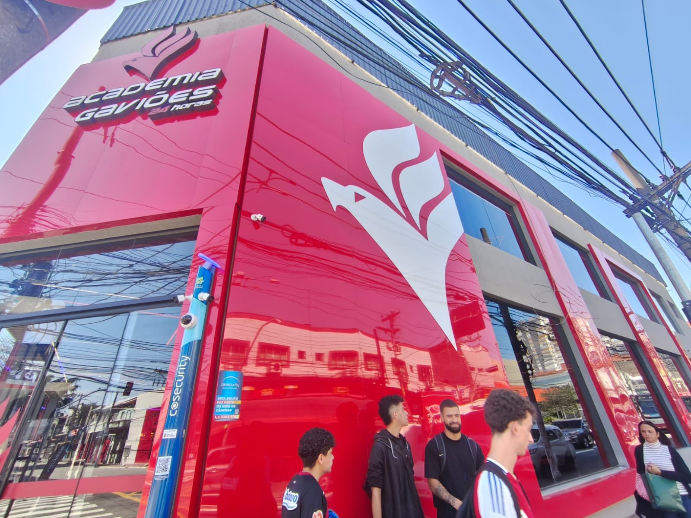
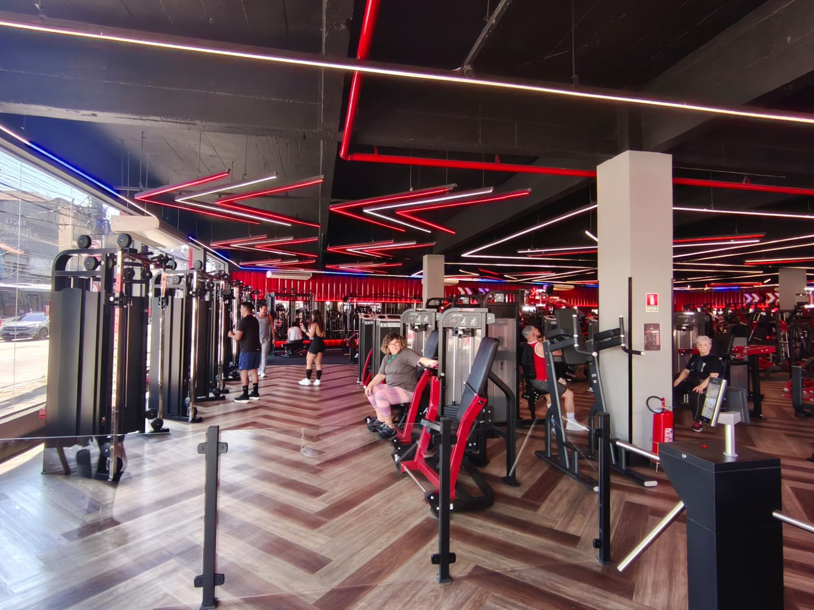

# Levantamento Institucional - Academia Gaviões

## 1. Informações Gerais da Organização
* **Nome da Organização:** Academia Gaviões
* **Endereço Completo:** Av. Celso Garcia, 5494 - Tatuapé, São Paulo - SP, 03064-000
* **Localização / Google Maps:** https://maps.app.goo.gl/436pmzrUuJrhkAcJ6
* **Responsável pelo Estabelecimento:** Eduardo Curzio
* **Telefone de Contato:** (11) 94074-7584
* **Data da Entrevista:** 21/09/2026

---

## 2. Contexto e Descrição do Negócio
A Academia Gaviões é um estabelecimento voltado para o fitness e bem-estar, oferecendo infraestrutura completa de musculação, salas para aulas coletivas (como spinning, muay thai, etc.) e serviços de gestão de planos e avaliações físicas para os alunos.

---

## 3. Processos Operacionais e Regras de Negócio Levantadas
Durante a visita e entrevista com o responsável, foram mapeados os seguintes fluxos essenciais para o sistema:
* **Gestão de Alunos e Matrículas:** O aluno escolhe um plano (mensal, trimestral, anual), sendo gerado um registo de matrícula associado ao pagamento.
* **Controle de Acessos:** A entrada na unidade é controlada por catraca eletrónica (biometria facial ou cartão), gerando registos de acesso por data e hora.
* **Treinos:** Os professores elaboram fichas de treino personalizadas compostas por vários itens de exercícios (com séries, repetições e cargas).
* **Aulas Coletivas:** Sessoes com horário fixo, limite de vagas e ministradas por instrutores específicos da unidade.
* **Manutenção e Estoque:** Controlo de inventário de materiais por filial e abertura de chamados de manutenção para equipamentos avariados.

---

## 4. Registo Fotográfico
Abaixo encontram-se os registos visuais obtidos durante a visita técnica e entrevista na unidade:

* **Entrevista no Ambiente da Academia:**
  

* **Infraestrutura e Organização da Academia:**
  
  